# AInVFX Fluid Studio

**English** | [简体中文](README.zh-CN.md)

> **Built on [AInVFX/ainvfx-fluid](https://huggingface.co/AInVFX/ainvfx-fluid).** This project is an offline studio (UI + pipeline) built around the AInVFX Fluid IC-LoRA for LTX-2.5. The LoRA and its training data are published by the AInVFX team on Hugging Face; models are not included here.

Paint the *shape* of smoke, steam, fire, explosions, water, dust, fog or clouds with a brush — the studio turns the color blobs into real fluid VFX and interpolates motion between keyframes. Video generation runs **fully offline** on your own GPU (LTX-2.5 + the AInVFX Fluid IC-LoRA, through a pinned ComfyUI backend).

> **This repository contains the project framework only. It does not ship or redistribute any model weights.** You download the models yourself from their official pages (links below) and accept each model's license there.

## Demo
Official demo cases (8 cases, 5 s each, 24 fps). The **input** is the keyframe images you paint (flat color blobs); the **output** is the video generated from them. Full-quality MP4s, including the complete control videos, are in [`examples/official-demos/`](examples/official-demos/).

| Case | Input: keyframe | Output: result | Original MP4 |
|---|---|---|---|
| Wildfire smoke on a hillside | 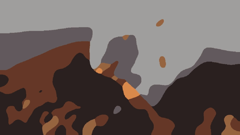| 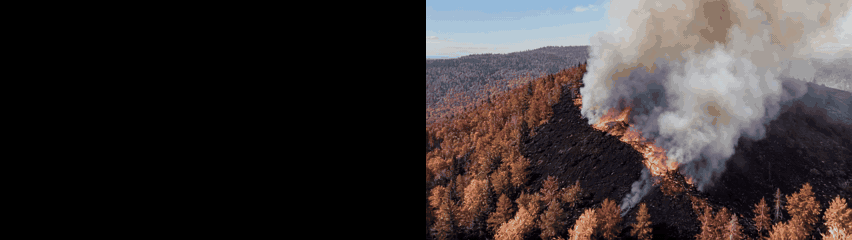 | [control](examples/official-demos/01_control.mp4) · [result](examples/official-demos/01_result.mp4) |
| Factory chimney smoke | 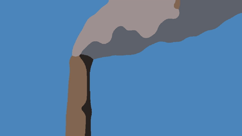|  | [control](examples/official-demos/02_control.mp4) · [result](examples/official-demos/02_result.mp4) |
| Smoke column on black (compositing element) | 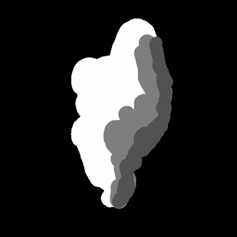|  | [control](examples/official-demos/03_control.mp4) · [result](examples/official-demos/03_result.mp4) |
| Fireball on black (compositing element) | | 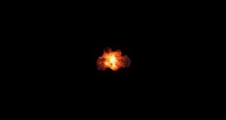 | [control](examples/official-demos/04_control.mp4) · [result](examples/official-demos/04_result.mp4) |
| Flame, vertical 9:16 | |  | [control](examples/official-demos/05_control.mp4) · [result](examples/official-demos/05_result.mp4) |
| Desert explosion | 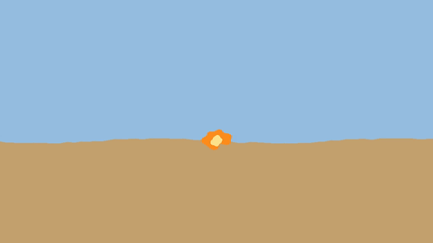|  | [control](examples/official-demos/06_control.mp4) · [result](examples/official-demos/06_result.mp4) |
| Ocean wave | |  | [control](examples/official-demos/08_control.mp4) · [result](examples/official-demos/08_result.mp4) |
| Colored smoke text | |  | [control](examples/official-demos/09_control.mp4) · [result](examples/official-demos/09_result.mp4) |

> The clips come from the official AInVFX Fluid demos (<https://huggingface.co/AInVFX/ainvfx-fluid>); credit goes to their authors. They are shown here to illustrate the workflow, and outputs of LTX-2.x models remain subject to the [LTX-2.x Community License](https://github.com/Lightricks/LTX-2/blob/main/LICENSE-2_x).

## Screenshots
The studio UI (left: tools and palette, center: canvas, right: references and prompt, bottom: timeline).

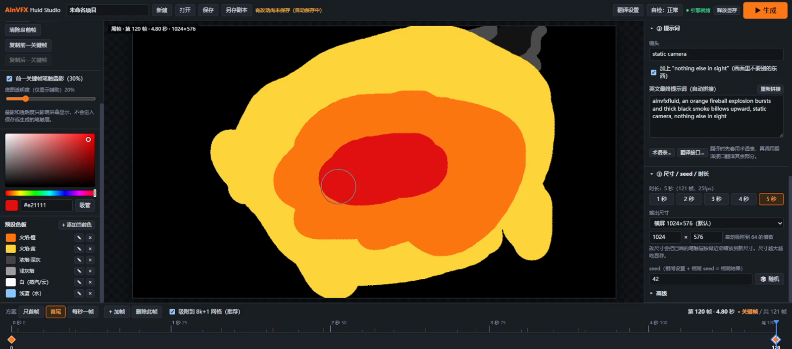
*Black base: paint flat color blobs for the explosion keyframe*

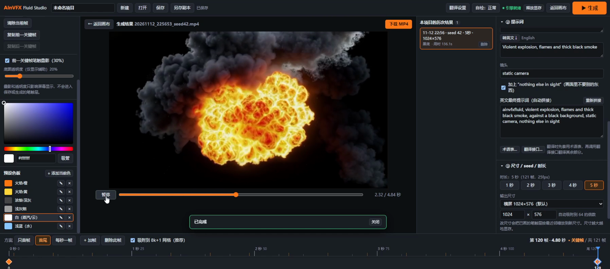
*Black base: generated fireball, ready to composite over your footage*

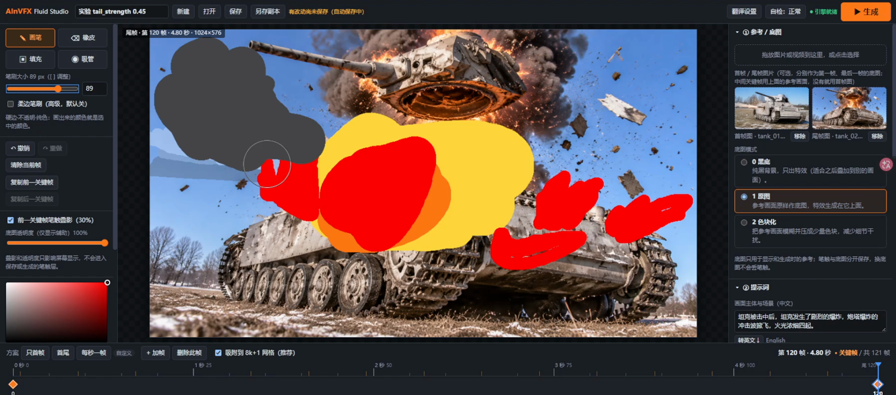
*Reference image: paint the effect directly on top of a tank photo*

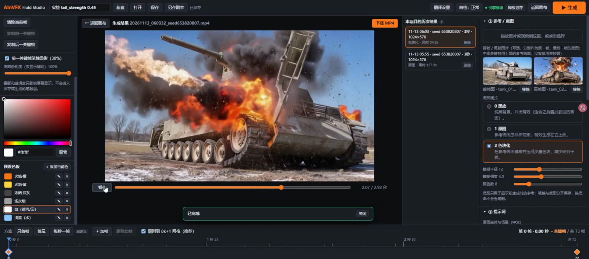
*Reference image: the generated explosion with the tank kept in place*

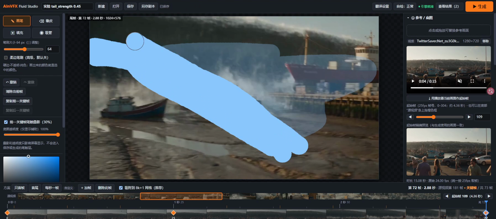
*Reference video: pick the start frame on the source strip and paint on the timeline*

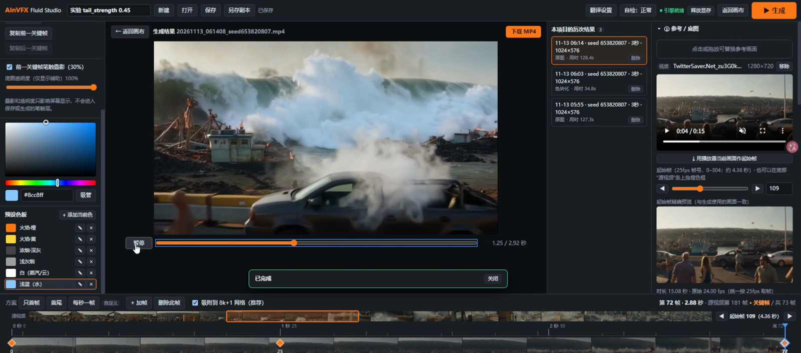
*Reference video: generated smoke and wave over the harbor footage*

## Requirements
- Windows 10/11 64-bit, NVIDIA GPU (designed and tested on **16 GB VRAM**; ≤12 GB untested), 64 GB RAM recommended, driver 580+.
- ~35 GB free disk (models ≈ 32 GB + engine ≈ 4 GB).
- Git for Windows (setup runs through its Git Bash); Node.js 18+ only if you want to rebuild the web UI.

## Setup
1. Install [Git for Windows](https://git-scm.com/download/win) (needed once), then clone this repository.
2. Double-click **`setup.bat`**. It downloads and builds everything except the models: embeddable Python 3.12, dependencies (incl. PyTorch CUDA, the large part), the pinned ComfyUI + custom nodes, and FFmpeg (~4 GB, needs internet; set `HTTPS_PROXY` if you need a proxy). It can be re-run safely; finished steps are skipped.
3. **Download the 5 models** into `models/` (see below; keep the file names). The in-app "Self-check" compares file sizes; SHA-256 values are in `models.manifest.json`.
4. Double-click `start.bat` (local only) or `start_lan.bat` (tablet/pen over LAN, token protected).

## Model downloads
| File | Put in | Size | Source | License / gate |
|---|---|---|---|---|
| `ltx-2.5-22b-distilled-transformer-comfy-int8-convrot.safetensors` | `models/diffusion_models/` | 21.5 GB | [Lightricks/LTX-2.5](https://huggingface.co/Lightricks/LTX-2.5/blob/main/diffusion_models/ltx-2.5-22b-distilled-transformer-comfy-int8-convrot.safetensors) | LTX-2.x Community License · **gated** |
| `gemma4-12b-with-proj-ltx-2.5-Q4_K_M.gguf` | `models/text_encoders/` | 8.4 GB | [elix3r/gemma4-12b-with-proj-ltx-2.5-GGUF](https://huggingface.co/elix3r/gemma4-12b-with-proj-ltx-2.5-GGUF/blob/main/gemma4-12b-with-proj-ltx-2.5-Q4_K_M.gguf) | See repo page (Gemma 4 / LTX terms) · **gated** |
| `ltx-2.5-video-vae-bf16.safetensors` | `models/vae/` | 1.5 GB | [Lightricks/LTX-2.5](https://huggingface.co/Lightricks/LTX-2.5/blob/main/vae/ltx-2.5-video-vae-bf16.safetensors) | LTX-2.x Community License · **gated** |
| `ltx-2.5-audio-vae-bf16.safetensors` | `models/vae/` | 0.36 GB | [Lightricks/LTX-2.5](https://huggingface.co/Lightricks/LTX-2.5/blob/main/vae/ltx-2.5-audio-vae-bf16.safetensors) | LTX-2.x Community License · **gated** |
| `ainvfx-fluid.safetensors` (IC-LoRA) | `models/loras/` | 0.65 GB | [AInVFX/ainvfx-fluid](https://huggingface.co/AInVFX/ainvfx-fluid/blob/main/ltx-2.5/ainvfx-fluid.safetensors) | LTX-2.x Community License (derivative); training data CC BY 4.0 |

Gated repos require you to log in to Hugging Face and accept the license on the repo page first. Users in China can replace `huggingface.co` with `hf-mirror.com`.

## Usage (short)
Pick a base-image mode → choose duration (1–5 s) and keyframe scheme → paint flat colors per keyframe (orange+yellow = fire/explosion, dark grey = thick smoke, light grey = smoke, white = steam/cloud, light blue+white = water) → fill the prompt form → **Generate**. Full instructions (Chinese): [`docs/README-原始说明.txt`](docs/README-原始说明.txt).

Optional Chinese→English prompt translation uses an external OpenAI-/Anthropic-compatible API that you configure in the UI (stored in your local `.env`, never committed). Video generation itself makes no network calls and has no telemetry.

## Example project
`examples/示例_坦克爆炸_3a7628/` is a ready-made demo (tank explosion; first/last keyframe + reference image). Copy the folder into `projects/` and refresh the app to open it. The example images are © cache-miss-hue, released under CC BY 4.0.

## Development
```bash
cd app/web && npm install && npm run build && npm test       # web UI
engine/python/python.exe -s tests/unit_backend_test.py        # GPU-free backend tests
```

## Licenses
- **This project's own code**: Apache-2.0 ([LICENSE](LICENSE)); `app/engine_nodes/` is GPL-3.0 because it runs inside ComfyUI.
- **Models are NOT covered by this license.** LTX-2.5 and the AInVFX Fluid LoRA are under the **LTX-2.x Community License**: free for individuals and entities with annual revenue **< US$10M**; entities ≥ US$10M need a paid commercial agreement from Lightricks beyond testing/evaluation, and the Acceptable Use Policy applies. The Gemma-based text encoder has its own terms. Read each model page before use or redistribution.
- Third-party components: see [NOTICE](NOTICE) and [`licenses/`](licenses/).
- This is not legal advice; verify the current terms on the official pages.
