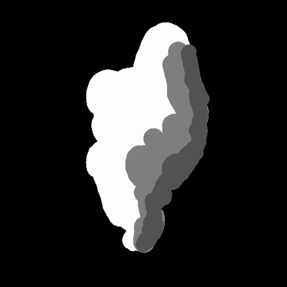
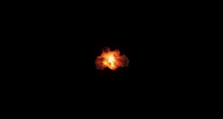
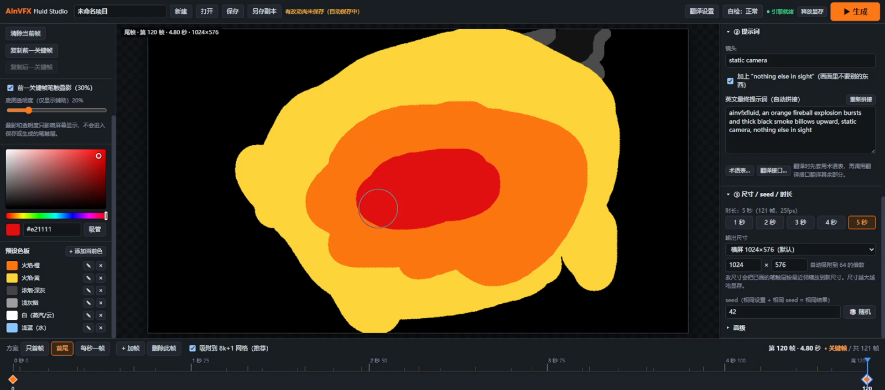
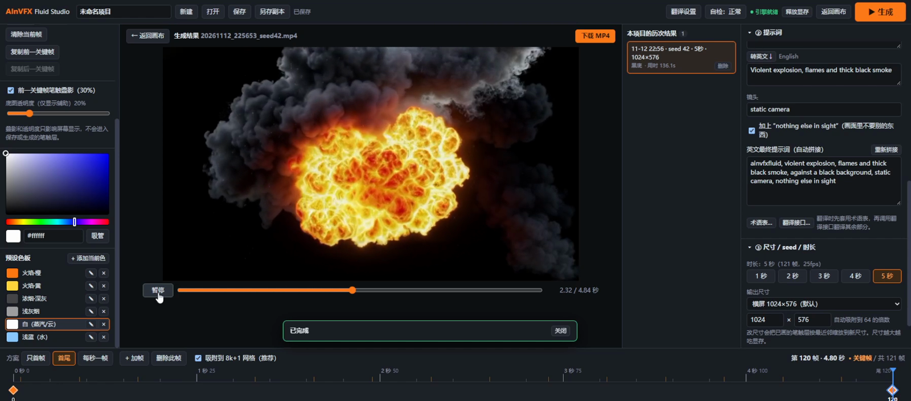
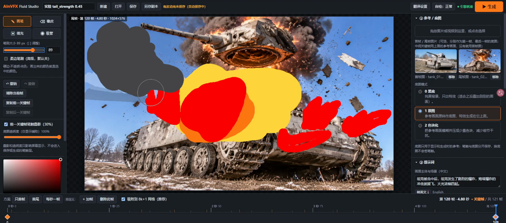
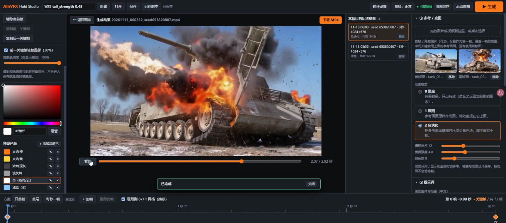
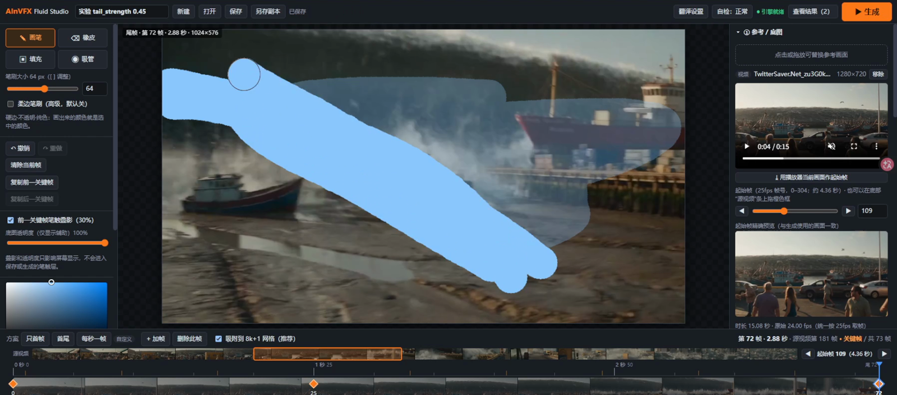
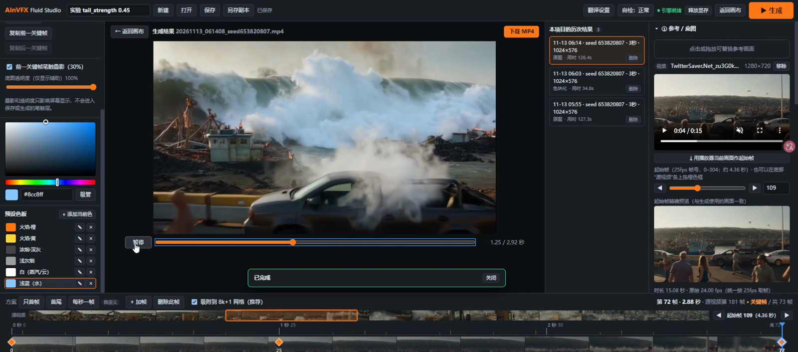

# AInVFX Fluid Studio · 多关键帧流体特效

[English](README.md) | **简体中文**

> **本项目基于 [AInVFX/ainvfx-fluid](https://huggingface.co/AInVFX/ainvfx-fluid) 构建。** 这是围绕 AInVFX Fluid（LTX-2.5 的 IC-LoRA）做的离线创作软件（界面 + 流程）。LoRA 与训练数据由 AInVFX 团队发布在 Hugging Face；本仓库不包含任何模型。

用画笔画出烟、蒸汽、火、爆炸、水、尘、雾、云的**形状**，软件把色块变成真实流体特效，并自动补出关键帧之间的运动。视频生成**全程离线**，使用本机显卡（LTX-2.5 + AInVFX Fluid IC-LoRA，经固定版本的 ComfyUI 后端）。

> **本仓库只提供项目框架，不包含、也不再分发任何模型权重。** 模型请从下方官方页面自行下载，并在对应页面同意其许可。

## 演示
官方演示案例（共 8 个，每个 5 秒、24 帧/秒）。**输入**是你画的关键帧画面（纯色色块），**输出**是据此生成的视频。原画质 MP4（含完整控制视频）在 [`examples/official-demos/`](examples/official-demos/)。

| 案例 | 输入：关键帧画面 | 输出：生成结果 | 原始 MP4 |
|---|---|---|---|
| 山坡山火浓烟 | |  | [control](examples/official-demos/01_control.mp4) · [result](examples/official-demos/01_result.mp4) |
| 烟囱排烟 | |  | [control](examples/official-demos/02_control.mp4) · [result](examples/official-demos/02_result.mp4) |
| 黑底烟柱（可叠加素材） | |  | [control](examples/official-demos/03_control.mp4) · [result](examples/official-demos/03_result.mp4) |
| 黑底火球（可叠加素材） | |  | [control](examples/official-demos/04_control.mp4) · [result](examples/official-demos/04_result.mp4) |
| 竖屏火焰 | |  | [control](examples/official-demos/05_control.mp4) · [result](examples/official-demos/05_result.mp4) |
| 沙漠爆炸 | |  | [control](examples/official-demos/06_control.mp4) · [result](examples/official-demos/06_result.mp4) |
| 海浪 | |  | [control](examples/official-demos/08_control.mp4) · [result](examples/official-demos/08_result.mp4) |
| 彩色烟雾文字 | |  | [control](examples/official-demos/09_control.mp4) · [result](examples/official-demos/09_result.mp4) |

> 这些视频来自 AInVFX Fluid 官方演示（<https://huggingface.co/AInVFX/ainvfx-fluid>），版权归原作者，此处仅用于说明工作流程；LTX-2.x 模型的输出仍受 [LTX-2.x 社区许可](https://github.com/Lightricks/LTX-2/blob/main/LICENSE-2_x) 约束。

## 界面截图
软件界面（左：工具与调色板，中：画布，右：参考图与提示词，下：时间轴）。


*黑底素材：在关键帧上用纯色色块画出爆炸形状*


*黑底素材：生成的火球，可叠加到你的视频上*


*参考图模式：在坦克照片上直接画出特效*


*参考图模式：生成的爆炸效果，坦克保持原样*


*参考视频模式：在源视频条上选起始帧，并在时间轴上画关键帧*


*参考视频模式：在港口素材上生成的烟浪效果*

## 运行要求
- Windows 10/11 64 位；NVIDIA 显卡，按 **16GB 显存**设计与测试（≤12GB 未测试）；建议 64GB 内存；驱动 580+。
- 约 35GB 磁盘空间（模型约 32GB + 引擎约 4GB）。
- 需要 Git for Windows（安装脚本通过其 Git Bash 运行）；只有想重新构建网页界面时才需要 Node.js 18+。

## 安装
1. 安装 [Git for Windows](https://git-scm.com/download/win)（只需一次），然后克隆本仓库。
2. 双击 **`setup.bat`**。它会自动下载并构建除模型以外的所有东西：Python 3.12 嵌入版、依赖（含 PyTorch CUDA，体积最大）、固定版本的 ComfyUI 与节点包、FFmpeg（共约 4GB，需联网；需要代理请先设置 `HTTPS_PROXY`）。可重复运行，已完成的步骤会跳过。
3. **下载 5 个模型**到 `models/` 对应子目录（见下表，文件名不要改）。启动后右上角“自检”会检查文件是否齐全、大小是否正确；SHA-256 见 `models.manifest.json`。
4. 双击 `start.bat`（仅本机）或 `start_lan.bat`（平板手写笔，局域网 + 口令保护）。

## 模型下载
| 文件 | 放到 | 大小 | 来源 | 许可 / 门禁 |
|---|---|---|---|---|
| `ltx-2.5-22b-distilled-transformer-comfy-int8-convrot.safetensors` | `models/diffusion_models/` | 21.5GB | [Lightricks/LTX-2.5](https://huggingface.co/Lightricks/LTX-2.5/blob/main/diffusion_models/ltx-2.5-22b-distilled-transformer-comfy-int8-convrot.safetensors) | LTX-2.x 社区许可 · **需同意条款** |
| `gemma4-12b-with-proj-ltx-2.5-Q4_K_M.gguf` | `models/text_encoders/` | 8.4GB | [elix3r/gemma4-12b-with-proj-ltx-2.5-GGUF](https://huggingface.co/elix3r/gemma4-12b-with-proj-ltx-2.5-GGUF/blob/main/gemma4-12b-with-proj-ltx-2.5-Q4_K_M.gguf) | 以仓库页面为准（Gemma 4 / LTX 条款）· **需同意条款** |
| `ltx-2.5-video-vae-bf16.safetensors` | `models/vae/` | 1.5GB | [Lightricks/LTX-2.5](https://huggingface.co/Lightricks/LTX-2.5/blob/main/vae/ltx-2.5-video-vae-bf16.safetensors) | LTX-2.x 社区许可 · **需同意条款** |
| `ltx-2.5-audio-vae-bf16.safetensors` | `models/vae/` | 0.36GB | [Lightricks/LTX-2.5](https://huggingface.co/Lightricks/LTX-2.5/blob/main/vae/ltx-2.5-audio-vae-bf16.safetensors) | LTX-2.x 社区许可 · **需同意条款** |
| `ainvfx-fluid.safetensors`（IC-LoRA） | `models/loras/` | 0.65GB | [AInVFX/ainvfx-fluid](https://huggingface.co/AInVFX/ainvfx-fluid/blob/main/ltx-2.5/ainvfx-fluid.safetensors) | LTX-2.x 社区许可（衍生模型）；训练数据 CC BY 4.0 |

带“需同意条款”的仓库须先登录 Hugging Face 并在仓库页面点同意。国内网络可把 `huggingface.co` 换成 `hf-mirror.com`。

## 使用（简版）
选底图模式 → 选时长（1–5 秒）和关键帧方案 → 每个关键帧纯色平涂（橙+黄=火/爆炸，深灰=浓烟，浅灰=烟，白=蒸汽/云，浅蓝+白=水）→ 填提示词表单 → **生成**。完整说明见 [`docs/README-原始说明.txt`](docs/README-原始说明.txt)。

“中文转英文”是可选功能，走你在界面里配置的外接大模型接口（OpenAI / Anthropic 兼容），密钥只保存在本机 `.env`，不会提交到仓库。视频生成本身不联网、无遥测。

## 示例项目
`examples/示例_坦克爆炸_3a7628/` 是现成的演示项目（坦克爆炸：首尾关键帧 + 参考图）。把整个文件夹复制到 `projects/` 里，刷新软件即可打开。示例图片版权归 cache-miss-hue，以 CC BY 4.0 发布。

## 开发
```bash
cd app/web && npm install && npm run build && npm test       # 网页界面
engine/python/python.exe -s tests/unit_backend_test.py        # 不占显卡的后端测试
```

## 许可
- **本项目自身代码**：Apache-2.0（[LICENSE](LICENSE)）；`app/engine_nodes/` 因在 ComfyUI 进程内运行，采用 GPL-3.0。
- **模型不在本许可范围内。** LTX-2.5 与 AInVFX Fluid LoRA 适用 **LTX-2.x 社区许可**：个人及年收入 **< 1000 万美元**的主体可免费使用；年收入 ≥ 1000 万美元的主体在测试评估之外的商用需与 Lightricks 另签付费协议，并须遵守可接受使用政策。基于 Gemma 的文本编码器另有其条款。使用或再分发前请阅读各模型页面。
- 第三方组件见 [NOTICE](NOTICE) 与 [`licenses/`](licenses/)。
- 本说明不构成法律意见，请以官方页面的最新条款为准。
